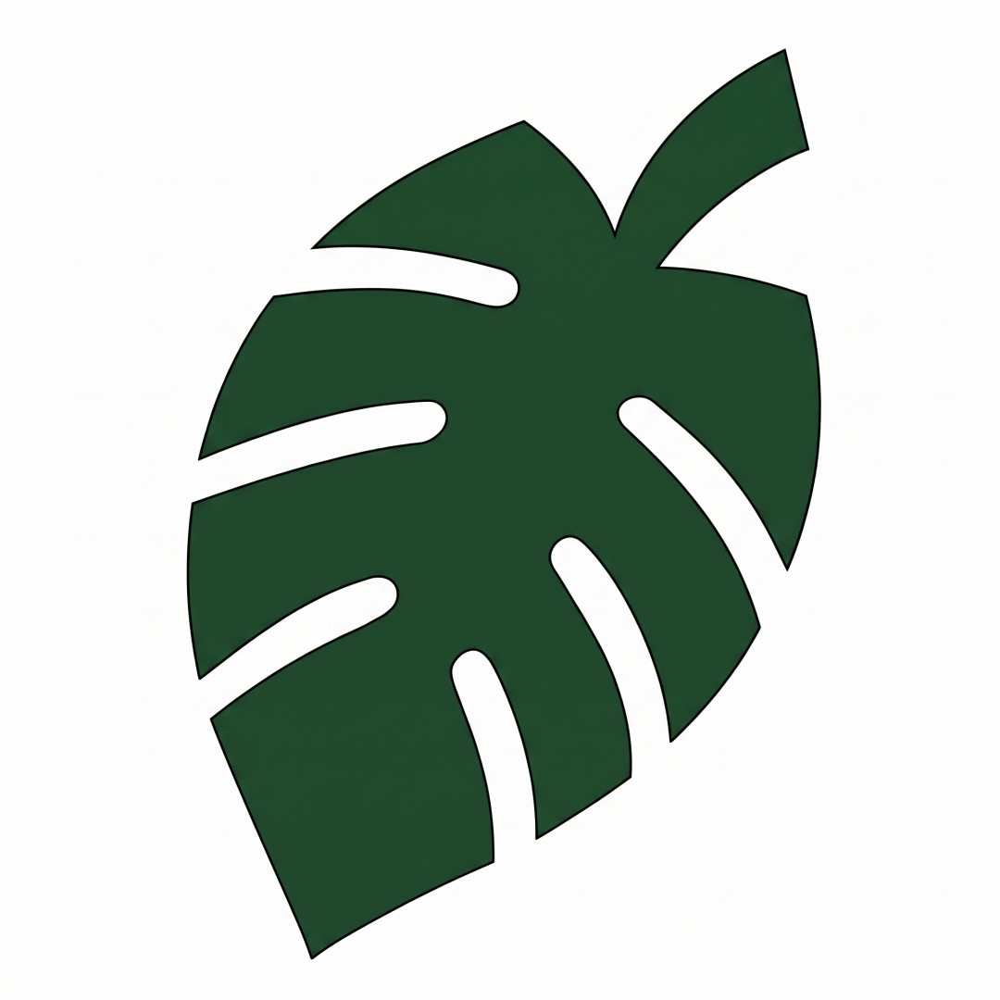
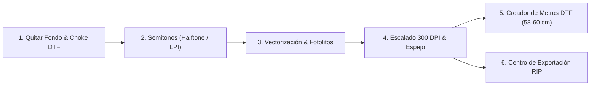

<div align="center">



# AmazoniaInk® Pro

### Suite Profesional de Preimpresión Textil, Semitonos, Separación de Tintas y Creador de Metros DTF

[](https://vitejs.dev/)
[](https://developer.mozilla.org/en-US/docs/Web/API/Canvas_API)
[-f59e0b?style=for-the-badge)](https://www.w3.org/TR/png/#11pHYs)
[](#arquitectura-y-privacidad)

**AmazoniaInk® Pro** es una estación de trabajo de preimpresión textil ejecutada íntegramente en el navegador (*100% Client-Side*). Diseñada para talleres de **impresión DTF (Direct to Film)**, **serigrafía textil** y **sublimación**, reúne en una sola interfaz extracción de fondos con contracción de base blanca (*Choke*), tramado de semitonos de *tacto cero*, separación vectorial de colores planos con marcas de registro y un **Creador Interactivo de Metros DTF (58–60 cm)** con empaquetado automático.

[Explorar Módulos](#-flujo-de-trabajo-y-módulos-de-producción) • [Creador de Metros DTF](#-creador-de-metros-dtf-5860-cm) • [Instalación Rápida](#-instalación-y-ejecución-local) • [Arquitectura Técnica](#-arquitectura-técnica-y-motores-de-imagen) • [Despliegue](#-despliegue-en-producción-y-github-pages)

</div>

---

## 🎯 Propósito e Ingeniería Aplicada a Producción Real

En la producción textil diaria, los errores más costosos provienen de archivos mal preparados antes de llegar al software RIP (*Cadlink Digital Factory*, *Maintop*, *AcroRIP*, *NeoStampa*):

- **Halos blancos indeseados en DTF:** Borde semitransparente que recibe tinta blanca y poliamida adhesiva.
- **Efecto «parche plástico» (*Bulletproof Print*):** Grandes masas de tinta sólida sobre prendas oscuras que impiden la transpiración.
- **Pérdida de escala física al importar en el RIP:** Archivos PNG exportados a 72 DPI nominales que se redimensionan incorrectamente al abrirlos en el plotter.
- **Desperdicio de película DTF:** Montajes manuales lentos en bobinas comerciales de **58 a 60 cm**.

**AmazoniaInk® Pro** resuelve cada uno de estos puntos críticos antes de exportar el archivo final de máquina.

---

## 🛠️ Flujo de Trabajo y Módulos de Producción



### 1. Quitar Fondo, Knockout y Contracción de Borde (*Choke DTF*)
- **Extracción por Contigüidad (*Flood-Fill BFS*) o *Knockout Total*:**
  - **Solo Exterior:** Elimina el fondo conectado a los márgenes del lienzo protegiendo zonas internas del mismo color dentro del arte. Traspasa automáticamente márgenes ya transparentes para limpiar marcos residuales.
  - **Knockout Total:** Vacía el color seleccionado en todo el diseño (ideal para aprovechar el negro o blanco de la propia camiseta).
- **Antialiasing proporcional (*Feather*) y Contracción de Borde (*Choke* de 0 a 4 px):** Erosión morfológica del canal alfa que retrae el borde opaco y elimina residuos semitransparentes (`alpha < 16`), evitando que asome el halo de base blanca en DTF.
- **Pinceles manuales de precisión:** Herramientas de **Cuentagotas**, **Borrador manual** y **Pincel de restauración** contra el archivo original.

### 2. Generador de Semitonos (*Halftone DTF & Serigrafía*)
- **3 Modos de Trama Especializados:**
  1. **Knockout de Sombra DTF (*Tacto Cero*):** Conserva los colores vivos del diseño y convierte sombras y degradados oscuros en tramas transpirables para prendas negras.
  2. **Fotolito Monocromo (Serigrafía 1 Tinta):** Puntos negros 100% opacos sobre transparencia pura para insolación de pantallas.
  3. **Cuatricromía CMYK Simulada:** Separación angular clásica de artes gráficas (`C: 15°`, `M: 75°`, `Y: 0°`, `K: 45°`).
- **Control Total de Trama:**
  - **Método:** Trama geométrica AM (*Círculo*, *Diamante*, *Línea*, *Cruz*) o difusión estocástica FM (*Floyd–Steinberg*).
  - **Frecuencia real en LPI (*Lines Per Inch*):** Configurable de `5 LPI` a `100 LPI` y ángulo libre (`0°` a `90°`).
  - **Curva Tonal Previa:** Ajuste de *Punto Negro*, *Punto Blanco*, *Gamma* y eliminación automática de fondo negro perimetral.

### 3. Vectorización K-Means y Separación de Colores (*Spot Colors*)
- **Cuantización cromática inteligente:** Agrupa la imagen entre **2 y 10 tintas planas** para serigrafía textil, ignorando píxeles transparentes y limpiando ruido mediante filtrado modal.
- **Edición interactiva por pantalla:** Permite ocultar/mostrar capas individuales, reasignar el color hexadecimal de cada tinta en vivo y consultar su porcentaje de cobertura.
- **Salidas listas para taller:**
  - **Trazado Vectorial SVG (`buildOptimizedSVG`):** Compresión por barrido horizontal (*Run-Length Encoding scanline*) agrupado por capas `<g id="capa-...">`.
  - **Fotolitos Individuales PNG:** Descarga de cada pantalla en negro 100% opaco con **marcas de registro serigráficas** opcionales.

### 4. Escalado Físico, Auditoría de DPI y Modo Espejo
- **Dimensionamiento exacto en `cm` o `in`:** Presets directos para *Escudo Pecho (10×10 cm)*, *A4*, *A3*, *A3+* y bobinas DTF.
- **Auditoría de Resolución Efectiva en Vivo:** Calcula los **DPI reales** a partir de las dimensiones nativas del archivo original frente al tamaño físico solicitado, alertando si la densidad cae por debajo del estándar óptimo de **300 DPI**.
- **Previsualización de Base Blanca (*White Underbase*):** Simula la máscara blanca con contracción (*Choke* de `0` a `8 px`) y permite exportarla por separado.

---

## 📏 Creador de Metros DTF (58–60 cm)

El módulo **5. Plancha DTF** despliega un entorno de trabajo a pantalla completa diseñado específicamente para el estándar comercial de impresión DTF por metros:

| Característica | Especificación Técnica |
| :--- | :--- |
| **Anchos Comerciales de Bobina** | **58 cm** (*Estándar Comercial DTF*), **60 cm** (*Bobina Completa*), **56 cm** (*Área útil segura*), **30 cm** (*Medio Rollo / A3*) |
| **Largo de Plancha Dinámico** | Calculado automáticamente en tiempo real (`cm` y `m`) según la caja delimitadora del último elemento colocado + margen |
| **Interacción Directa en Lienzo** | Selección, arrastre libre con imán (*Snap*) a bordes y centro, redimensionado desde esquinas, rotación `±90°` y espejo `H/V` |
| **Auto-Compactación (*Auto-Nest*)** | Algoritmo de empaquetado *Shelf Best-Fit* ordenado por altura que minimiza los metros lineales consumidos |
| **Creación Automática (*Auto-Build*)** | Modal por lotes para definir ancho (`cm`) y cantidad de copias de todas las imágenes subidas y armar el pliego en un clic |
| **Rellenar Fila (*Auto-Fill Row*)** | Calcula cuántas repeticiones caben en los 58–60 cm de ancho respetando el margen configurado y completa la fila automáticamente |
| **Auto-Trim de Transparencia** | Recorta al vuelo el aire transparente sobrante alrededor de cada PNG al subirlo para no desperdiciar película DTF |
| **Diagnóstico Visual de Calidad** | Bordes codificados por color según DPI efectivos (**Verde** `≥300`, **Amarillo** `≥250`, **Rojo** `≥200`, **Negro** `<200`) y alerta de **Superposición / Fuera de rollo** |

---

## 🧪 Muestras Corporativas y Cartas de Calibración Incluidas

La aplicación incorpora tres patrones maestros generados vectorialmente a **1000×1000 px** para validar cada etapa sin depender de imágenes externas de baja calidad:

1. **🌿 Logo AmazoniaInk® (`brand`):** Emblema corporativo oficial en alta definición sobre placa neutra `#e2e5e6`, diseñado para probar extracción de fondo en 1 clic, *Choke DTF* y repetición de escudos en plancha.
2. **🎯 Carta Halftone DTF (`halftone`):** Carta técnica con esfera de degradado continuo, anillo de luminancia y cuña de 10 pasos de gris (`10%–100%`) sobre fondo carbón `#141418`, ideal para calibrar el *Knockout de Sombra* y la frecuencia LPI.
3. **🛡️ Sello 4 Tintas Spot (`spot`):** Insignia industrial compuesta estrictamente por 4 tintas planas sin degradados, lista para verificar la separación cromática SVG y la generación de fotolitos serigráficos.

---

## 🏗️ Arquitectura Técnica y Motores de Imagen

```
App_dtf/
├── src/
│   ├── App.jsx                         # Estación principal, historial Undo/Redo y motores de edición
│   ├── GangSheet.jsx                   # Creador interactivo de metros DTF (58-60 cm × largo dinámico)
│   ├── main.jsx                        # Punto de entrada React 18
│   └── utils/
│       ├── backgroundRemoval.js        # Flood-fill BFS contiguo, knockout global y erosión de borde (Choke)
│       ├── gangSheetLayout.js          # Motor matemático de distribución en bobina y cálculo de aprovechamiento
│       ├── printProduction.js          # Cálculo de rasterizado físico e inyección binaria del chunk PNG pHYs (CRC32)
│       ├── underbase.js                # Generador de máscara de base blanca DTF con umbral anti-halo
│       ├── projectStore.js             # Persistencia local en IndexedDB (proyectos, historial y pliegos)
│       └── *.test.js                   # Suite de pruebas unitarias automatizadas (Node Test Runner)
├── sources/
│   └── logo.jpeg                       # Activo de marca oficial AmazoniaInk® en alta resolución
└── vite.config.js                      # Configuración de compilación y Web Workers
```

### Inyección Binaria de Densidad Física (`pHYs` Chunk PNG)
Los navegadores exportan los lienzos HTML5 a `72 DPI` por omisión. El módulo [`src/utils/printProduction.js`](./src/utils/printProduction.js) intercepta el binario PNG generado y escribe directamente el bloque estándar **`pHYs`** (con suma de verificación `CRC32` calculada al vuelo) indicando los píxeles por metro exactos (`11811 ppm` para `300 DPI`). Así, al importar el PNG en **Cadlink**, **Maintop**, **Photoshop** o **Illustrator**, el archivo se abre exactamente con sus centímetros reales de impresión.

### Arquitectura y Privacidad
Todo el procesamiento de píxeles, vectorización y empaquetado de planchas se ejecuta localmente en la memoria del navegador del usuario mediante `TypedArrays` (`Uint8ClampedArray`, `Uint32Array`) y `IndexedDB`. **Ningún diseño ni propiedad intelectual de tus clientes se sube a servidores externos.**

---

## 🚀 Instalación y Ejecución Local

### Requisitos Previos
- **Node.js** `>= 18.0.0`
- **npm** `>= 9.0.0`

### Pasos de Instalación

```bash
# 1. Clonar el repositorio
git clone https://github.com/josemejias081/AmazoniaInk-Pro.git
cd AmazoniaInk-Pro

# 2. Instalar dependencias
npm install

# 3. Iniciar el servidor de desarrollo con recarga en caliente (HMR)
npm run dev
```

Abre `http://localhost:5173/` en tu navegador.

### Comandos Disponibles

| Comando | Descripción |
| :--- | :--- |
| `npm run dev` | Inicia el servidor de desarrollo Vite en `http://localhost:5173/` |
| `npm test` | Ejecuta las 19 pruebas unitarias de motores DTF, DPI, `pHYs`, `Choke` y `GangSheet` |
| `npm run build` | Genera la compilación optimizada de producción en la carpeta `dist/` |
| `npm run preview` | Sirve localmente la compilación de producción para verificación final |

---

## 🌐 Despliegue en Producción y GitHub Pages

El repositorio cuenta con integración continua mediante **GitHub Actions** (`.github/workflows/`):

1. En tu repositorio de GitHub, dirígete a **Settings → Pages**.
2. En **Build and deployment → Source**, selecciona **GitHub Actions**.
3. Cada `push` a la rama `main` ejecuta automáticamente la compilación de producción y actualiza el sitio publicado.

---

<div align="center">
  <sub>Desarrollado con precisión para la industria gráfica y textil • <strong>AmazoniaInk® Pro</strong></sub>
</div>
